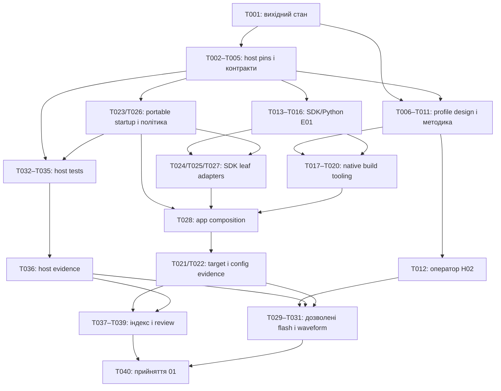

# Завдання: 01-foundation — основа й апаратний профіль

**Дата**: 2026-10-28. **Стан**: завдання сформовано; жодного не виконано цією фазою.
**Каталог**: `SPECIFY_FEATURE_DIRECTORY=specs/01-foundation` — явно для кожного workflow script.
**Входи**: [spec.md](spec.md), [plan.md](plan.md), [research.md](research.md),
[data-model.md](data-model.md), [контракти](contracts/), [quickstart.md](quickstart.md),
[узгоджений checklist](checklists/foundation-readiness.md),
[рішення D01–D23](../../docs/decisions.md), ухвалена конституція v1.0.0.
Setup повернув саме `/Users/mac/Projects/Scopa/rc-pwm-bridge/specs/01-foundation`
і `/Users/mac/Projects/Scopa/rc-pwm-bridge/.specify/templates/tasks-template.md`.

## Формат і обмеження

- `Tnnn` — унікальний ID; `[USn]` — історія; `[P]` — можлива паралельна робота
  після названих передумов, у різних файлах. Це можливості, не команда запускати агентів.
- Шляхи в завданнях відносні до кореня репозиторію. Майбутні файли ще не існують;
  їх поява або checkbox не означає проходження перевірки.
- Тести обов'язкові за FR-011 і конституцією IV: змістовні outcomes, межі та faults.
  Окремого test-first циклу або погодження кожного тесту немає.
- Тільки startup-каркас: permission завжди false; у 01 немає RC capture,
  duty mapping, LEDC PWM, operational arming/cutoff, radio/network, Arduino чи Nano build.
  1000–2000 мкс → 0–100% і 1000 Гц зберігаються як інваріанти наступних етапів.
- RC=GPIO3, PWM=GPIO0; GPIO1 не використовується. DIR–GND — постійна перемичка
  на MD20A (D20), жодних DIR GPIO-операцій. Живлення плати — зовнішні 3,3 В на 3V3/GND.
- D21: SC-004 у 01 охоплює SuperMini. RC/MD20A мають документальні вимоги й
  pending/owner/gate; фактичний RC — 03 до підключення, драйвер — 04, силовий тракт — 06.
- D23: supervisor poll 10 мс номінальний; init retry не раніше completion +
  1 000 000 мкс, на першому доступному poll. Верхня межа target lateness у 01
  не задається; окремий target-timing образ/вимір не додається.
- D22: одна спроба передачі нового sequence; consumer poll 100 мс не є heartbeat.
  Zero/partial write — drop без replay при наступному poll/USB reconnect.
- Зберігати роботу користувача. Не створювати/перемикати гілки, не комітити,
  не пушити, не підключати RC/MD20A/насос і не виконувати апаратних дій автоматично.
  Операторські T012/T030/T031 вимагають окремого явного завдання користувача;
  сам запуск Implement їх не дозволяє. За відсутності дозволу/обладнання залишати `[ ]`.
- Старі raw дані `specs/01-foundation/verification/board-usbmodem1101-2026-10-28/`
  не змінювати. ROM chip/flash/USB докази не є host/build/startup acceptance.

## Фаза 1 — Підготовка виконання

**Мета**: зберегти вихідний стан і підготувати лише спільні host-залежності.

- [ ] T001 Зафіксувати Git HEAD, dirty/untracked стан і SHA-256 усіх використаних джерел, включно з незакоміченими, у `specs/01-foundation/verification/acceptance.md`; записати початкові E01/H01–H05 та SC-001–SC-008 без вигаданих pass, перевірити відсутність конфлікту з наявними файлами. (R12; FR-014–FR-016; SC-008; залежності: немає.)
- [ ] T002 Підготувати й перевірити host-набір D14: macOS arm64, Apple clang 21.0.0/build clang-2100.1.1.101, CLTools 26.6.0.0.1781586589, SDK 26.5, CPython 3.11.7, CMake 3.30.2, Ninja 1.12.1; записати actual versions/hashes і host scope у `tools/environment/environment.lock.json`, залишивши target closure pending. Не змінювати pins при розбіжності. (R02; FR-002; SC-001; залежить від T001.)

## Фаза 2 — Спільні переносимі контракти й host-точка входу

**Мета**: дати кодовим історіям спільні контракти без SDK/GPIO.
Документальні T006/T007/T008/T011 можуть починатися після своїх передумов,
не чекаючи всієї фази. E01 не є глобальним блокуванням цих робіт або host-гілки.

- [ ] T003 Описати в `firmware/components/bridge_core/include/bridge/startup.hpp` стандартні C++11 типи MonotonicUs/StartupPhase/RetryPolicy/InitOutcome/StartupSnapshot, snapshot now_valid/останній валідний now_us, API tick/result і terminal faults, включно з явним повідомленням невалідного clock без штучного timestamp, за data-model/startup contract; зафіксувати 5 спроб, 1 000 000 мкс і незмінний permission=false. Без SDK/FreeRTOS/GPIO, heap, RTTI та exceptions. (R02,R08; FR-007–FR-011; SC-003; залежить від T002.)
- [ ] T004 Визначити в `firmware/components/platform_esp32/include/platform/startup_port.hpp` SDK-незалежні C++17 контракти clock/profile/output/setup/diagnostic ports із clock-validity/error до signed→unsigned conversion, OutputApplyResult та snapshot-межі до 96 байтів; передбачити fake ports для спільної політики порядку й доставки, а SDK-виклики залишити leaf-адаптерам. Не розширювати API переносимого core апаратними типами. (R02,R08; FR-007,FR-008,FR-010; SC-003; залежить від T003.)
- [ ] T005 Реалізувати host-режим `python3 scripts/build.py host --build-dir DIR` у `scripts/build.py` і standalone `tests/host/CMakeLists.txt`: core strict C++11/extensions OFF із target-private -fno-rtti/-fno-exceptions, тестована platform-політика C++17, CMAKE_EXPORT_COMPILE_COMMANDS=ON, потрібні executables startup_tests/negative_probe/core_header_probe. Перевіряти тільки host pins, відмовляти для зайнятого DIR, не потребувати IDF/MCU; відсутні ще source-файли не видавати за успішну збірку. Коди 0/1/2/3 — за build contract, без flash/monitor/reset/clean side effects. (R02,R12; FR-002,FR-003,FR-010,FR-011; SC-001–SC-003; залежить від T002–T004.)

## Фаза 3 — US1: перевірені межі апаратної плати (P1, перший інкремент)

**Мета**: матеріалізувати погоджений профіль і відокремити його design approval
від фізичного прийняття SuperMini та відкладених RC/MD20A інтерфейсів.
**Незалежна перевірка**: огляд джерел/профілю та host preflight без MCU;
SC-004 повністю приймається лише після застосовних фізичних доказів T012.

- [ ] T006 [P] [US1] Створити `firmware/boards/c3-supermini-pinout-01.json` за `hardware/esp32-c3-supermini-profile.md`: unit c3-supermini-188b0e93032c, C3 QFN32 rev v0.4, 4 194 304 bytes XMC, native USB, RC=3/PWM=0, direction_mode=hardwired_low без dir_pin, зовнішні 3V3/GND. Зберегти фото/pinout/ROM provenance, unknown factory metadata, design approval окремо від pending фізичних даних; flash mode/frequency/layout поки явно невибрані. (R01,R02,R08; FR-004–FR-006,FR-016; SC-004; залежить від T001; D17–D21.)
- [ ] T007 [P] [US1] Доповнити `specs/01-foundation/verification/board-review.md` документальними RC/MD20A вимогами з локальних джерел: рівні/ground/conditioning gate, DIR–GND, PWM LOW=brake, software/bias/emergency cutoff як різні обов'язки, без перенесення low-side diode. Позначити actual RC/MD20A дані pending із власниками 03/04/06; зберегти історичний ROM-звіт і raw. (R01,R08,R12; FR-004,FR-006,FR-012,FR-016; SC-004; залежить від T001; D21.)
- [ ] T008 [US1] До target configure обрати й обґрунтувати flash mode/frequency/partition layout за первинними джерелами pinned SDK та конкретного embedded flash, записати точні значення у `firmware/boards/c3-supermini-pinout-01.json`, підставу в `specs/01-foundation/research.md`, рішення в `docs/decisions.md` і `specs/01-foundation/spec.md`. Не підставляти SDK defaults; якщо потрібні відсутні факти/вибір користувача — зберегти блокування й отримати їх до залежного configure. Не додавати OTA/NVS feature. (R02; FR-002,FR-004,FR-016; SC-001,SC-004; залежить від T006.)
- [ ] T009 [US1] Додати до `scripts/build.py` profile preflight і генерацію header лише в build DIR: перевіряти chip/flash, обов'язкові build settings, provenance/design approval, RC/PWM конфлікти та hardwired DIR без GPIO1; reject до configure для invalid/unapproved профілю. Pending H02/H03 і RC/MD20A не повинні блокувати design build; додаткова схема/continuity не потрібна. Fingerprint має дозволяти простежити точні вхідні дані. (R01,R02,R08; FR-004–FR-006,FR-016; SC-004; залежить від T005,T008.)
- [ ] T010 [US1] Створити й виконати stdlib unittest у `tests/tooling/test_build_contract.py` для profile preflight: absent/unapproved/conflicting pins, wrong chip/flash, missing flash settings, неприпустимий DIR GPIO, прийняття погодженого design із pending фізичними/RC/MD20A полями. На тимчасових fixtures підтвердити fail до header/configure; результат додати до `specs/01-foundation/verification/board-review.md`, без заяви про hardware pass. (R02,R08,R12; FR-004–FR-006,FR-015; SC-004; залежить від T007,T009.)
- [ ] T011 [P] [US1] Підготувати `specs/01-foundation/verification/hardware.md`: схема power bench і зовнішнього PWM bias для 3V3/GND, окремий статус USB+external режиму, обрані за реальними даними прилад/номінали та числова методика H03 — LOW limit, похибка/калібрування, bandwidth/sample interval, мінімальний імпульс, trigger/pretrigger, duration/repeats. Відсутні дані запросити до стенда, не вгадувати; вимірювання залишити not_run. (R08,R12; FR-006,FR-012,FR-013,FR-015; SC-004,SC-006; залежить від T006,T007.)
- [ ] T012 [US1] ОПЕРАТОР, лише після окремого явного завдання: перевірити фактичне живлення й зовнішній PWM bias SuperMini за H02, без RC/MD20A/насоса; зберегти виміряні значення/умови в `specs/01-foundation/verification/hardware.md` і висновок застосовних полів SC-004 у `specs/01-foundation/verification/board-review.md`. За відсутності дозволу/приладу залишити задачу й gate відкритими; не вимагати фактичних RC/MD20A даних для SC-004 у 01. (R01,R08,R12; FR-004,FR-006,FR-012,FR-015; SC-004; залежить від T008,T011; D21.)

**Контрольна точка US1**: T006–T010 дають design/preflight-інкремент без плати.
T012 — окремий фізичний результат; його очікування не блокує portable код або target build.

## Фаза 4 — US2: відтворювана цільова збірка (P1)

**Мета**: закрити E01, реалізувати native ESP-IDF build і конфігураційний review.
**Незалежна перевірка**: чиста C3-збірка й окремий config review без підключення
до плати. Фінальна збірка потребує software-частини US3, а не її фізичного прийняття.

- [ ] T013 [US2] Підготувати SDK ESP-IDF v5.5.6 commit `880a203ae603d08a94d06aa01e0d6761958e5e9e` з точними submodules та tools для macOS arm64; перевірити riscv32-esp-elf esp-14.2.0_20260121, CMake 3.30.2, Ninja 1.12.1 і hashes архівів із RCH-01. Зберегти точні requirements/constraints/tools manifest, їх hashes і target inventory в `tools/environment/environment.lock.json`, не змінюючи host pins. Це bootstrap, не закриття E01. (R02; FR-002,FR-016; SC-001; залежить від T002.)
- [ ] T014 [US2] На CPython 3.11.7 у чистому staging venv розв'язати повну Python closure, включно з pip/build tooling; створити `tools/environment/requirements.lock.txt`, `tools/environment/wheels.sha256` і wheelhouse у `tools/environment/wheelhouse/`, додати exact versions/distribution hashes до `tools/environment/environment.lock.json`. Не обмежуватись pip freeze, плаваючими constraints чи component dependencies.lock. (R02; FR-002; SC-001; залежить від T013.)
- [ ] T015 [US2] Реалізувати `scripts/environment/check.py --manifest tools/environment/environment.lock.json`: version/hash/submodule/config checks і перевірка повноти closure/replay evidence, без install або автоматичного переписування pins; exit 3 для незадоволеного environment gate. Host-режим build має перевіряти свій subset без залежності від незакритого target E01. (R02,R12; FR-002,FR-003; SC-001; залежить від T014.)
- [ ] T016 [US2] Відтворити другий чистий venv із wheelhouse через `--no-index --require-hashes`, перевірити SDK Python dependencies і actual tool versions; записати commands/codes/hashes у `specs/01-foundation/verification/build.md` як environment evidence. Закрити E01/Q01 тільки за успіху, оновивши статус у `docs/open-questions.md` і `specs/01-foundation/spec.md`; target build поки not_run. (R02,R12; FR-002,FR-014–FR-016; SC-001; залежить від T015.)
- [ ] T017 [US2] Після E01 створити `firmware/CMakeLists.txt`, `firmware/main/CMakeLists.txt` і `firmware/sdkconfig.defaults`: root firmware, target esp32c3, COMPONENTS main до project.cmake, явні deps, CMAKE_EXPORT_COMPILE_COMMANDS=ON, C++17 app, затверджені flash settings, log levels 0, FreeRTOS tick 100 Hz, native USB/secondary none. Не включати esp_wifi/bt/esp_netif/lwip, managed components, NVS-сервіс чи RMT/LEDC init. (R01,R02,R10; FR-001–FR-003,FR-009; SC-002,SC-005; залежить від T009,T016.)
- [ ] T018 [US2] Розширити `scripts/build.py` target-режимом `python3 scripts/build.py target --board-profile FILE --build-dir DIR`: E01 + profile/settings preflight перед native idf.py build з firmware root, generated header/sdkconfig у DIR, явні 0/1/2/3 codes і відмова для зайнятого DIR. Зберегти незалежний host-режим; жодних flash/erase/reset/monitor/Git/automatic clean side effects. (R02,R12; FR-002–FR-006; SC-001,SC-002; залежить від T009,T015,T017.)
- [ ] T019 [P] [US2] Реалізувати `scripts/verify/config.py` з CLI `--build-dir DIR` для generated sdkconfig, actual component graph/map і startup-source review: forbidden dependencies/init paths, log levels, tick, USB routing/config, actual target-core C++11/PRIVATE -fno-rtti/-fno-exceptions flags, bootloader/panic/watchdog settings. Розрізняти автоматичні перевірки й явно записаний ручний source review; один ESP_WIFI_ENABLED=n або відсутній артефакт не є pass. (R08,R10,R12; FR-009,FR-013–FR-015; SC-005,SC-007; залежить від T017.)
- [ ] T020 [US2] Розширити й виконати `tests/tooling/test_build_contract.py` для CLI 0/1/2/3, missing/mismatched pins, invalid profile до configure, зайнятого build DIR без видалення, forbidden component/config evidence та відсутності flash/monitor/reset side effects. Використати fake subprocess/build fixtures як software tests, а не C3 evidence; результати записати в `specs/01-foundation/verification/build.md`. (R02,R10,R12; FR-003,FR-009,FR-014,FR-015; SC-001,SC-002,SC-005; залежить від T010,T018,T019.)
- [ ] T021 [US2] Виконати чисту native C3-збірку через `scripts/build.py target --board-profile firmware/boards/c3-supermini-pinout-01.json --build-dir build/c3-01-clean` після появи всіх software source; зберегти actual command/code, lock/submodule versions, profile/source fingerprints, sdkconfig, map та hashes firmware artifacts у `specs/01-foundation/verification/build.md`. Не підключатися до порту й не прошивати; H02/H03 не є передумовами цієї збірки. (R01,R02,R12; FR-001–FR-006,FR-014,FR-015; SC-001,SC-002; залежить від T018,T020,T028.)
- [ ] T022 [US2] Виконати `scripts/verify/config.py --build-dir build/c3-01-clean` та належний source review, зберегти окремий actual результат у `specs/01-foundation/verification/config-review.md`: radios/network відсутні, немає RC/LEDC/arming/DIR path, startup logging не блокує LOW, номінальні tick/poll settings за D23 перевірені по config/source без заяви про виміряний target jitter; actual target-core compile options відповідають C++11/extensions OFF/-fno-rtti/-fno-exceptions; SDK watchdog/panic/bootloader effects та їх власники записані. Build pass не підміняє цей review або фізичну boot safety. (R01,R08,R10,R12; FR-001,FR-007–FR-009,FR-013–FR-015; SC-005,SC-007; залежить від T019,T021.)

**Контрольна точка US2**: E01 має власний доказ T016; build T021 і config review T022 —
окремі результати. US3 operator T030/T031 і навіть підключена плата для них не потрібні.

## Фаза 5 — US3: startup із забороненою роботою насоса (P1)

**Мета**: реалізувати LOW-first, bounded retries та D22-діагностику без operational control.
**Незалежна перевірка**: software-контракт через shared host suite US4;
окремо — операторські GPIO0 cold start/reset спостереження SC-006.
Фізичний результат не можна замінити host-тестами або target build.

- [ ] T023 [P] [US3] Реалізувати в `firmware/components/bridge_core/startup.cpp` переходи AwaitingAttempt/Attempting/RetryWait/ReadyDisabled/Exhausted/ClockFault: 5 спроб, пауза 1 000 000 мкс від completion, успіх без arming, п'ята невдача без auto reset. Обробити now regression/deadline overflow/result protocol faults без unsigned wrap або нових спроб; RC не є входом, permission завжди false. Це host-незалежна від target E01 гілка. (R08; FR-007,FR-008,FR-010,FR-011; SC-003; залежить від T003.)
- [ ] T024 [P] [US3] Після E01 реалізувати `firmware/components/platform_esp32/gpio_safe_output.cpp`: перевірка compiled profile перед GPIO-access, preload LOW latch до output mode на GPIO0, ідемпотентність і точний OutputApplyResult. Невідповідність профілю не підставляє pins; помилка assert LOW зупиняє решту init. Не конфігурувати RC capture чи DIR/GPIO1, не ініціалізувати LEDC. (R01,R08; FR-004,FR-005,FR-007,FR-008; SC-004,SC-006; залежить від T004,T009,T016.)
- [ ] T025 [P] [US3] Після E01 реалізувати `firmware/components/platform_esp32/monotonic_clock.cpp` через esp_timer_get_time(): невід’ємні uint64 мкс поточного boot через спільну checked conversion з T026: від’ємний raw/error до cast веде в terminal ClockFault без штучного timestamp, deadline/init, без logging/sleep/auto reboot. Не вигадувати RC timeout або watchdog policy. (R08; FR-008,FR-010; SC-003; залежить від T004,T016,T026.)
- [ ] T026 [US3] Реалізувати спільну SDK-незалежну політику startup-послідовності й diagnostic event/sequence у `firmware/components/platform_esp32/include/platform/startup_port.hpp`, доступну fake ports: перевірка clock-validity/signed значення до cast, далі profile → assert LOW → решта локального setup → outcome/snapshot; early failure не виконує наступних кроків. Початковий snapshot та зміни phase/attempt/deadline/error/output-result створюють подію; лише timestamp/reconnect — ні. Core API залишається time/result, апаратні leaf calls — зовні. (R08; FR-007,FR-008,FR-010,FR-011; SC-003; залежить від T004,T023; D22.)
- [ ] T027 [US3] Після E01 реалізувати `firmware/components/platform_esp32/local_diagnostics.cpp`: static mailbox на 1 snapshot, producer без очікування, consumer нижчого пріоритету poll 100 мс, запис до 256 байтів, USB write timeout 0/TX512/RX64. Одна спроба на новий sequence; zero/partial write позначає його обробленим без replay/heartbeat/flush/stdout/command parser. Setup driver/worker ідемпотентний, setup failure — init failure, відсутній host — ні. (R08; FR-008,FR-010; SC-003; залежить від T004,T016,T026; D16,D22.)
- [ ] T028 [US3] Скласти каркас у `firmware/main/app_main.cpp` і component registration у `firmware/components/bridge_core/CMakeLists.txt`, `firmware/components/platform_esp32/CMakeLists.txt`: core strict C++11/extensions OFF із target-private -fno-rtti/-fno-exceptions, platform C++17, явні deps, LOW до console/setup, core clock/result loop із номінальним poll 10 мс та bounded retries, без обіцянки верхньої межі target lateness (D23), D22 consumer окремо. ReadyDisabled/Exhausted/ClockFault не дозволяють роботу; немає RC/RMT/LEDC/arming/network/NVS/DIR/esp_restart path. (R01,R02,R08,R10; FR-001,FR-007–FR-010; SC-002,SC-003,SC-005,SC-006; залежить від T017,T023–T027.)
- [ ] T029 [US3] Підготувати остаточну процедуру й перевірити готовність стенда в `specs/01-foundation/verification/hardware.md`: фактичні H02/H03, прилад/числові межі до виміру, cold start і manual reset тільки PWM GPIO0, від'єднані RC/MD20A/насос, точні hashes image/profile/config зі свіжих software evidence. Окремо позначити очікування дозволу T030/T031; якщо profile/code змінилися після evidence, повторити лише залежні build/config/host перевірки до апаратних дій. (R08,R12; FR-012–FR-015; SC-004,SC-006; залежить від T011,T012,T021,T022,T036.)
- [ ] T030 [US3] ОПЕРАТОР, лише після окремого явного завдання на flash: перевірити живу unit/port identity, погоджений power mode й від'єднані RC/MD20A/насос; записати рівно прийнятий image з T029 та actual flash command/code/hashes у `specs/01-foundation/verification/hardware.md`. Не додавати automatic flash до build wrapper, не erase_all/eFuse, не вигадувати незмінність старого port name. Без дозволу залишити `[ ]`. (R08,R12; FR-003,FR-013–FR-015; SC-006; залежить від T029.)
- [ ] T031 [US3] ОПЕРАТОР, лише після окремого явного завдання на вимірювання: виконати cold start і manual reset за погодженою H03, зберегти raw traces у `specs/01-foundation/verification/startup/` та actual LOW/імпульси/межі/кількість повторів у `specs/01-foundation/verification/hardware.md`. Вимірювати GPIO0 SuperMini від подачі живлення, не DIR/MD20A/витрату; pass/fail лише в межах resolution. Відсутній прилад/доказ або виявлений імпульс залишає SC-006 відкритим/невдалим. (R08,R12; FR-007,FR-012–FR-015; SC-006; залежить від T030.)

**Контрольна точка US3**: T023–T028 — software, T032–T036 — його meaningful host
verification, T030/T031 — окремі апаратні дії. Відсутність D22-повідомлення після
drop сама не доводить firmware fault і не є підставою автоматично reset-перезавантажувати плату.

## Фаза 6 — US4: змістовні host-перевірки й окремі докази (P2)

**Мета**: отримати реально виконаний host suite та чесний acceptance index.
**Незалежна перевірка**: host build/CTest/negative probe без SDK або MCU;
index повинен показувати missing/blocked physical evidence, не приховувати його.

- [ ] T032 [P] [US4] Реалізувати explicit-check harness у `tests/host/test_support.hpp` і state/deadline suite у `tests/host/startup_tests.cpp`: permission=false у всіх станах; до першого запиту clock now_valid=false саме по собі не є ClockFault; початкова/п'ять спроб, успіх третьої, 999999/1000000 мкс, completion-relative minimum deadline, запізнілий tick з однією спробою без catch-up, повторний tick, reset нової сесії, regression/overflow/protocol fault. Не використовувати assert як єдиний механізм; source tests можуть готуватися за контрактом до core implementation, без обов'язкового test-first. (R08,R12; FR-007,FR-008,FR-011; SC-003; залежить від T003,T005.)
- [ ] T033 [P] [US4] Створити `tests/host/negative_probe.cpp`, який використовує той самий harness з T032 і навмисно невірне очікування, друкує його причину та завершується ненульовим кодом. Не робити просто return 1 без перевірки; не реєструвати його як звичайний успішний CTest case. (R08,R12; FR-011; SC-003; залежить від T032.)
- [ ] T034 [P] [US4] Доповнити `tests/host/startup_tests.cpp` fake-port перевірками спільної політики T026: invalid/negative raw clock до cast або clock-port failure → terminal ClockFault без init/GPIO/setup і permission=false, snapshot now_valid=false з останнім валідним now_us або 0 (не поточний вимір); profile mismatch без GPIO, LOW-first, output/transport/worker failure та early stop, повторний setup без дублювання driver, відсутній/blocked host без впливу на permission/producer. Для D22 охопити одну спробу на sequence, zero/partial drop, відсутність replay при poll/reconnect, terminal без heartbeat і наступну нову подію; DIR викликів немає. SDK/реальних GPIO у host target немає. (R08,R12; FR-007,FR-008,FR-010,FR-011; SC-003; залежить від T026,T032.)
- [ ] T035 [P] [US4] Створити `tests/host/core_header_probe.cpp` для strict C++11/public-header isolation без SDK/MCU; compile probe є додатковим доказом меж, не заміною поведінкового suite. Actual host-core compiler dependency/options і відсутність heap-залежностей перевіряються в T036; target-core audit належить T022 і не є передумовою host suite. (R02,R12; FR-010,FR-011; SC-003; залежить від T003,T005.)
- [ ] T036 [US4] Виконати `scripts/build.py host --build-dir build/host-01-clean`, CTest із startup_tests та додатковим isolation probe, потім negative_probe окремою командою; записати actual compiler/manifest/source identities, stdout/codes і перевірені сценарії в `specs/01-foundation/verification/host.md`. Перевірити actual host-core C++11/extensions OFF/-fno-rtti/-fno-exceptions options у compile_commands.json, compiler dependency output без SDK/GPIO/FreeRTOS headers та окремо core source без heap-залежностей; flags самі не доводять відсутності heap. Main suite мусить пройти, negative probe — чесно дати ненульовий code без маскування. Не вимагати target E01 чи плату. (R02,R08,R12; FR-003,FR-007,FR-008,FR-010,FR-011,FR-014,FR-015; SC-003; залежить від T005,T023,T026,T032–T035.)
- [ ] T037 [US4] Заповнити в `specs/01-foundation/verification/acceptance.md` індекс VerificationRecord для host/target_build/config_review/board_review/physical з R/FR/SC/scenario IDs, командами/умовами, expected/actual і посиланнями на raw; відсутні фізичні докази позначити blocked/not_run. Зв'язати T-IDs з доказами та source fingerprints, не зараховувати ROM/host/build як фізичне прийняття або відкладені RC/MD20A gates як pass. (R12; FR-014–FR-016; SC-008; залежить від T010,T022,T036; фізичні T012/T031 можуть залишатися відкритими.)

## Фаза 7 — Документація та завершальне прийняття

- [ ] T038 Узгодити фактично реалізовані команди й обмеження в `specs/01-foundation/quickstart.md`, `firmware/README.md`, `tests/README.md`, `scripts/README.md` та `README.md`: точні pins/dependencies/BOARD_PROFILE, host окремо від target, D20–D23, операторські кроки й непроведені перевірки. Прибирати статус «майбутня команда» лише для реально готового tooling; не переписувати `PROJECT_FOUNDATION.md` або input prompts. (R01,R02,R08,R10,R12; FR-001–FR-016; SC-001–SC-008; залежить від T022,T036,T037.)
- [ ] T039 Провести фінальний review шести принципів конституції й повноти R/FR/SC→T→evidence у `specs/01-foundation/verification/acceptance.md`; перевірити актуальність hashes/config і звірити усі сценарії US1–US4. Залишити bootloader/upload власникам 04/06, brownout — 06, watchdog — 05/06; нові блокувальні рішення записувати в spec/decisions, без зміни конституції чи додавання наступних фаз. (R01,R02,R08,R10,R12; FR-013–FR-016; SC-007,SC-008; залежить від T037,T038.)
- [ ] T040 Прийняти ітерацію 01 лише за фактичного виконання SC-001–SC-008, записавши рішення в `specs/01-foundation/verification/acceptance.md` та узгоджений стан `docs/roadmap.md`; фізичні T012/T031 мають бути виконані з доказами. Якщо хоч один обов'язковий критерій blocked/not_run/fail, залишити цю задачу `[ ]` і roadmap незавершеним; не переходити автоматично до 02 або іншої Spec Kit фази. (R12; FR-014–FR-016; SC-001–SC-008; залежить від T012,T031,T039 та всіх обов'язкових критеріїв.)

## Залежності й порядок виконання

Номери впорядковують огляд за історіями; це **не** вимога завершити кожну US цілком
до початку наступної. Виконувати DAG із залежностей у рядках задач.
Підготовка host/profile документів не повинна чекати full target E01 або приладу.

На схемі групи узагальнено: точні передумови окремих задач наведено в їхніх рядках.
Наприклад, T006/T007 не потребують host tooling, а T036 не потребує E01/T016.

### Межі блокування

| Gate | Які задачі дають потрібний результат | Що чекає на нього |
|---|---|---|
| Host pins | T002 | Переносимий код/host tooling T003–T005, host verification; не документальний огляд T006/T007 |
| E01 / Q01 | T013–T016 | SDK leaf code T024/T025/T027, native project T017 і залежна target-збірка; не T023/T026/T032–T036 |
| Flash build settings / Q01,Q02 | T008 | Profile preflight/generation T009 і залежний target configure; не portable core/host suite |
| H01 design | T006–T010, на основі вже погоджених D17–D20 | Target profile; відсутня додаткова схема/continuity не є новим блокером |
| H02 / H03 | Методика T011, фактичний H02 T012, перевірка готовності T029 | Окремо дозволені flash/спостереження T030/T031 та фізичне прийняття; не build T021 |
| RC/MD20A H04/H05 | Документальна основа T007, фактичні gates 03/04/06 | Лише майбутнє підключення/інтеграція; не SC-004 у 01 за D21 |

### Залежності історій і незалежні інкременти

| Історія | Передумови та залежності | Самостійний результат |
|---|---|---|
| US1 (P1) | Документи після T001; parser після host wrapper; фізичний H02 окремо | Design/profile preflight без плати; SC-004 тільки із застосовними фактичними доказами |
| US2 (P1) | E01, US1 design, software composition US3 | Clean C3 build і config review без фізичних US1/US3 кроків |
| US3 (P1) | Core після host pins; SDK leaf після E01; фізичне прийняття після US2 build, US4 suite та H02/H03 | Завжди заборонена робота; окремий GPIO0 startup/reset waveform |
| US4 (P2) | Core/SDK-free політика US3 та host pins; target-звіти потрібні лише для повного індексу T037 | Host suite/probe без SDK/плати; чесний індекс missing evidence |

Між US2 build і US3 physical немає циклу: **T028 software → T021 build → T031 physical**.
US4 suite T036 перевіряє software US3 до апаратних дій й не чекає його фізичного прийняття.

## Приклади паралельної роботи

Це приклади допустимих пар після виконання передумов, без фактичного запуску агентів.
Паралельність не дозволяє одночасно редагувати один файл.

| Історія | Приклад |
|---|---|
| US1 | T006 (board JSON) і T007 (board review) після T001; T011 (hardware worksheet) і T008 (flash settings) після готовності profile/doc inputs |
| US2 | T019 (config checker) і T018 (target wrapper) після T017; T013–T016 SDK bootstrap може тривати паралельно з host-only T023/T032/T035 |
| US3 | T024 (GPIO leaf) і T025 (clock leaf) після T004/T009/T016 та готової T026; T023 core може готуватися незалежно, коли його передумови готові |
| US4 | T033 (negative probe) і T034 (startup/fake-port suite) після T032 та готової T026; T035 isolation probe — окремий файл |

Не паралелити T005/T009/T018 (`scripts/build.py`), T010/T020
(`tests/tooling/test_build_contract.py`), T032/T034 (`startup_tests.cpp`),
T004/T026 (`startup_port.hpp`) або writers одного verification record.

## Стратегія реалізації та MVP

1. Перший інкремент US1: source provenance, board JSON, документальні RC/MD20A межі
   та profile preflight T006–T010 після потрібних host-передумов. Це design MVP,
   не завершення SC-004 або 01; фізичний T012 може залишатися blocked.
2. Незалежний software-інкремент: host contracts, T023/T026 та US4 T032–T036.
   Він дає перевірений retry/diagnostic контракт без SDK чи плати.
3. Паралельно закрити E01; після нього — SDK adapters/composition і US2 target/config evidence.
4. Підготувати index/інструкції з видимими missing checks. Лише за окремими явними
   завданнями користувача виконати T012/T030/T031, після чого переоцінити застосовні докази.
5. T040 і roadmap завершуються тільки за всіма обов'язковими SC; жодного автоматичного
   переходу до наступної ітерації. Після зміни критичних source/profile/settings
   повторюються лише залежні перевірки й оновлюються fingerprints.

## Простежуваність вимог і прийняття

| Вимоги | Основні задачі | SC / місце доказів |
|---|---|---|
| R01 / FR-001 | T006,T017,T024,T028,T022,T031 | SC-002,SC-006; build.md, config-review.md, hardware.md |
| R02 / FR-002 | T002,T008,T013–T016 | SC-001; environment.lock.json, verification/build.md |
| R02,R12 / FR-003 | T005,T018,T020,T021,T036 | SC-001–SC-003; verification/build.md, host.md |
| R01,R02,R08 / FR-004,FR-005 | T006,T008–T010,T012,T024 | SC-004; board JSON, verification/board-review.md, hardware.md |
| R01,R08 / FR-006 | T006,T007,T011,T012 | SC-004; verification/board-review.md, hardware.md |
| R08 / FR-007,FR-008 | T003,T004,T023–T028,T032–T034,T036,T031 | SC-003,SC-006; verification/host.md, hardware.md |
| R10 / FR-009 | T017,T019–T022,T028 | SC-005; verification/config-review.md |
| R02 / FR-010 | T003–T005,T023,T026,T035,T036 | SC-003; verification/host.md |
| R08,R12 / FR-011 | T032–T036 | SC-003; verification/host.md |
| R08 / FR-012 | T007,T011,T012,T029,T031 | SC-004,SC-006; verification/board-review.md, hardware.md |
| R08,R12 / FR-013 | T011,T019,T022,T029–T031,T039 | SC-006,SC-007; verification/hardware.md, config-review.md, acceptance.md |
| R12 / FR-014,FR-015 | T001,T010,T012,T016,T020–T022,T029–T031,T036–T040 | SC-008; окремі записи verification/ та raw attachments |
| R02,R08,R12 / FR-016 | T007,T008,T016,T037,T039 | SC-001,SC-004,SC-008; docs/decisions.md, spec.md, verification/acceptance.md |

Назви записів без повного префікса в таблиці означають
`specs/01-foundation/verification/`. T-IDs деталізують наявні R/FR/SC, не змінюють їх.

## Поточний результат генерації

40 задач: Setup — 2, Foundational — 3, US1 — 7, US2 — 10, US3 — 9, US4 — 6,
завершальна фаза — 3. Усі `[ ]`: генерація не виконувала bootstrap, код, тести,
target build, flash або вимірювання. Гілку/commit/push не змінювала.
`.specify/extensions.yml` відсутній: before_tasks та after_tasks hooks не зареєстровані.
Наступний можливий крок — окремо запитаний Analyze; автоматично його не запускати.

Після генерації окремо завершено guided Analyze: [analysis-resolution.md](analysis-resolution.md).
D23 застосовано до init poll/retry; усі 40 задач залишаються невиконаними.
Наступна фаза — Implement лише за окремим запитом із дотриманням E01/H-gates.
