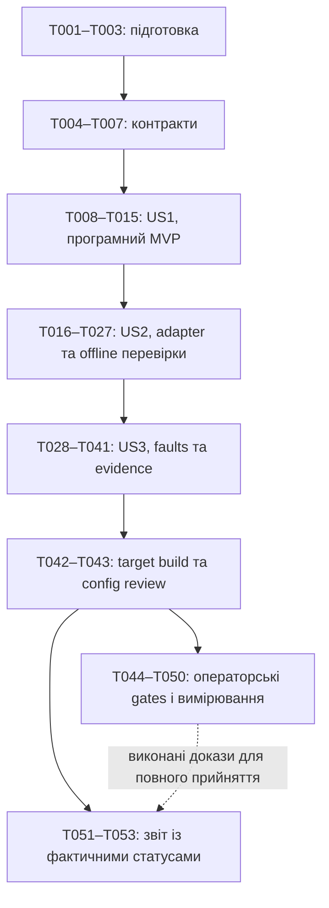

# Задачі: 04-pump-output — PWM до MD20A без насоса

**Дата:** 2026-10-30. **Гілка:** `04-pump-output`, без перемикання. **Стан:** Tasks сформовано; всі задачі нижче ще не виконані.

**Вхід:** [spec.md](spec.md), [plan.md](plan.md), [research.md](research.md), [data-model.md](data-model.md), [контракт](contracts/pump-output.md), [quickstart.md](quickstart.md), [чекліст 33/33](checklists/pump-output-boundaries.md), [D57–D62](../../docs/decisions.md), [current-baseline](../../speckit-iteration/current-baseline.md), ратифікована конституція v1.0.0 та AGENTS.md. Успадковані джерела/evidence01–03 прочитано; старі статуси roadmap не скасовують програмних результатів.

**Workflow:** `SPECIFY_FEATURE_DIRECTORY=specs/04-pump-output` явно для кожного workflow script. `setup-tasks.sh --json` повернув `/Users/mac/Projects/Scopa/rc-pwm-bridge/specs/04-pump-output` та `/Users/mac/Projects/Scopa/rc-pwm-bridge/.specify/templates/tasks-template.md`. Промпти залишаються входами. У цій фазі створюється лише цей файл; Implement/Analyze, firmware тести/build, Git commit/push і hardware дії не запускаються.

**Тести обов’язкові:** FR-012, конституція IV та AGENTS.md вимагають meaningful tests для зміненої поведінки. Порядок «tests → implementation» нижче відображає залежності/контракти; обов’язкового test-first/TDD циклу немає. Наявні 01–03 suites зберігаються, їхнє історичне проходження не є доказом 04.

**Шляхи:** portable `firmware/components/bridge_core/`; SDK adapters `firmware/components/platform_esp32/`; композиція `firmware/main/`; host `tests/host/`; tooling `tests/tooling/`; записи результатів `specs/04-pump-output/verification/`. Нові planned files створює майбутній Implement, а не Tasks.

**Межі:** один input GPIO3/output GPIO0, native IDF v5.5.6, DIR hardware GND без MCU control, normal LOW/disarmed. Bench — окремий образ без насоса, одна скінченна сесія/boot за D59. Немає operational RC→pump/arming/clear/timeout Q05, command input, нових GPIO/Arduino/radio/реверсу. MD20A LOW — brake, не power isolation/coast/нуль витрати.

**Виконання:** звичайні кодові/host/build задачі застосовують чинні програмні залежності; Q02/Q03/Q06 блокують залежне підключення/фізичне прийняття, не unrelated portable роботу. Завдання з описом **ОПЕРАТОР** агент автоматично не виконує навіть у майбутньому Implement: потрібні окреме явне апаратне завдання та підтверджені фізичні передумови. Створення процедури/порожнього звіту їх не закриває. Невиконані операторські пункти залишаються `[ ]`; проміжний software звіт дозволений із blocked/not_run hardware, повне прийняття 04 — ні.

**Паралельність:** `[P]` означає незалежні write-paths після виконання явних prerequisites; це можливість, не вказівка запускати субагентів. За відсутності `[P]` shared files обробляються послідовно. Розділення на історії не приховує інтеграційних залежностей: US1 має незалежний model MVP; target waveform потребує US2, повний апаратний доказ усіх історій — US3.

## Фаза 1: Підготовка

**Мета:** Перевикористати програмні результати 01–03 й зафіксувати фактичні gates; не створювати проєкт заново.

**Незалежна перевірка / checkpoint:** Власники залежностей та початковий стан записані; наявні зміни користувача збережені. Неперевірене обладнання не є передумовою host-роботи.

- [ ] T001 Зафіксувати HEAD/гілку, наявні зміни й source hashes у specs/04-pump-output/verification/prerequisites.md; звірити acceptance 01–03, D57–D62 та checklist 33/33, зберегти відкриті 01 H02/H03 і 03 T043–T047/T051; відрізнити дозвіл software-підготовки від hardware suitability (R12; FR-010,FR-013; SC-006).
- [ ] T002 [P] Перевірити tools/environment/environment.lock.json через scripts/environment/check.py та записати фактичний результат/версії/локальні шляхи у specs/04-pump-output/verification/environment.md; зберегти IDF v5.5.6 commit 880a203ae603d08a94d06aa01e0d6761958e5e9e, C++11/C++17, наявний build workflow; недоступне середовище блокує відповідний build, не підміняється новою версією (R02; FR-012). Залежить від T001.
- [ ] T003 [P] Підготувати specs/04-pump-output/verification/hardware-procedure.md за quickstart P1–P5 і контрактом: no-pump для всіх boot, Q02/Q03/Q06, окремі disconnected/powered-driver умови, M04/E/U/прилад/raw provenance, матриця repeat/reader/trace-step; позначити всі фізичні дії операторськими й непроведеними (R01,R08,R12; FR-009–FR-011). Залежить від T001.

## Фаза 2: Спільні контракти

**Мета:** Визначити мінімальні спільні типи й перевірювану SDK-межу до реалізації історій.

**Незалежна перевірка / checkpoint:** Portable заголовок проходить strict C++11 probe без MCU/FreeRTOS/I/O; повноваження власника й типи результатів не плутають API success із фізичним рівнем.

- [ ] T004 Оголосити BenchConfig/BootContext/OutputSession, OutputRequest/ApplyResult/OutputSnapshot, OutputEvidence і stress CaptureWindowEvidence interfaces у firmware/components/bridge_core/include/bridge/pump_output.hpp за data-model.md: units/ranges, stable wire codes, sticky reason masks, presence semantics, одна сесія/boot; жодних IDF/FreeRTOS/GPIO типів або нових operational permissions (R03,R08; FR-003–FR-008; D59/D61/D62). Залежить від T002, T003.
- [ ] T005 Оголосити один EspPumpOutput та мінімальну testable SDK/clock/fault-observation межу у firmware/components/platform_esp32/include/platform/pump_output.hpp; передбачити startup LOW і одноразовий owner handoff, per-operation raw status/brackets та fault check до/після nonzero API без lock навколо SDK; host перевірятиме production adapter через fake SDK boundary (R03,R08; FR-005,FR-007). Залежить від T004.
- [ ] T006 Додати tests/host/pump_output_header_probe.cpp та його реєстрацію у tests/host/CMakeLists.txt; скомпілювати strict C++11 probe portable public API без platform include paths, IDF/FreeRTOS/I/O; не замінювати probe перевіркою тексту заголовка (R03; FR-012; SC-006). Залежить від T004.
- [ ] T007 Створити у specs/04-pump-output/verification/acceptance.md матрицю R/FR/US.AC/SC → задачі/майбутній доказ, включно з D61/D62; початкові host/build/physical результати not_run, кожний blocked має owner/причину, Q05→05 та motor direction/power path→06 (R12; FR-013; SC-006). Залежить від T005, T006.

## Фаза 3: US1 — початок і завершення ізольованої перевірки (P1, програмний MVP)

**Мета:** Створити одну скінченну сесію на app boot, default normal LOW та compile-time відокремлення стендового образу.

**Незалежна перевірка / checkpoint:** Host/fake-port: normal LOW за довільного RC/reader; bench 5 с +6×10 с або 6×100 с, terminal LOW/no-repeat, fault-priority й новий boot за D59. Цей MVP перевіряє модель; фізична US1.AC2–4 потребує US2/US3 та операторських задач нижче.

- [ ] T008 [P] [US1] Додати tests/host/pump_output_policy_tests.cpp: normal і all reset reasons; readiness на 5 с±1 мкс; шість повних plateau/65 с/605 с; lateness 999/1000/1001 мкс, no catch-up; fault одночасно з deadline, regressive/overflow time та generation, invalid percent, no-repeat після valid/resync/reconnect/retry; fake clock/port без sleeps і реального MCU (R08; FR-003,FR-004; US1.AC1–4; SC-001,SC-004). Залежить від T007.
- [ ] T009 [P] [US1] Розширити tests/tooling/test_build_contract.py: target-only --pump04-bench waveform|stress|accuracy, explicit accuracy trace-step 0..5 без default; відхилити host/rc03-bench conflict/step без accuracy/out-of-range; normal default-off, відмінні immutable config/build identities іфіксована stress window duration601000000 мкс/output duration600000000 мкс за D62; негативні cases мають expected nonzero exit (R02,R08; FR-004,FR-012; US1.AC1–2). Залежить від T007.
- [ ] T010 [US1] Реалізувати finite OutputPolicy у firmware/components/bridge_core/pump_output.cpp і зареєструвати у firmware/components/bridge_core/CMakeLists.txt та tests/host/CMakeLists.txt: immutable 0/25/40/50/80/100, initial LOW 5 с, absolute deadlines, lateness>1 мс→Fault, terminal LOW, checked time/generation, fault-priority; core effective duty 0/work_permitted=false, жодного RC/USB вибору точки (FR-003–FR-007; US1.AC1–4; D59/D60). Залежить від T008.
- [ ] T011 [US1] Додати у firmware/main/Kconfig.projbuild default-n BRIDGE_PUMP04_BENCH і compile-time scenario/trace-step; створити firmware/sdkconfig.pump04-waveform.defaults, firmware/sdkconfig.pump04-stress.defaults, firmware/sdkconfig.pump04-accuracy.defaults із правильними trace03/stress03 settings; normal baseline bench не вмикає, жодних runtime/NVS/console параметрів (FR-004,FR-012; US1.AC1–2). Залежить від T010.
- [ ] T012 [US1] Реалізувати прийняті pump04 flags/валідацію у scripts/build.py, із новими build directories, source/config SHA256 та scenario/trace-step manifest; кожний 04 fragment сам задає 03 instrumentation, сумісність зі старими 01–03 командами зберегти; не додавати flash/device access (R02,R12; FR-004,FR-012). Залежить від T011, T009.
- [ ] T013 [US1] Розширити scripts/verify/config.py прапором --require-pump04 normal|waveform|stress|accuracy: перевіряти actual sdkconfig/objects/profile/variant/trace-step, відповідність 03 options, output end605 с/evidence end606 с для stress за D62 та default-off normal; порушення відхиляти, а не лише звіряти ім’я directory (R01,R02,R03; FR-001,FR-012). Залежить від T012.
- [ ] T014 [US1] Оновити firmware/components/platform_esp32/startup_policy.cpp, firmware/components/platform_esp32/include/platform/startup_port.hpp і tests/host/startup_tests.cpp для sticky startup_had_failure та metadata одноразового handoff; зберегти 5 спроб/паузу 1 с D15: жодна успішна повторна init не повертає bench eligibility цього boot (R08; FR-003–FR-005; US1.AC4,US3.AC1). Залежить від T010, T013.
- [ ] T015 [US1] Зареєструвати policy suite у tests/host/CMakeLists.txt, виконати US1 host/probe/tooling fixtures та застосовну startup regression; записати команди/expected/actual/exits/hashes у specs/04-pump-output/verification/host.md. Перевірити model-only MVP, не заявляти target waveform або physical acceptance (R12; FR-012,FR-013; SC-004,SC-006). Залежить від T014, T006.

## Фаза 4: US2 — duty та сталі endpoints (P1)

**Мета:** Реалізувати реальний GPIO0/LEDC adapter, один output writer та перевірюваний архів/аналіз форми сигналу.

**Незалежна перевірка / checkpoint:** Production adapter з fake SDK відтворює всі 1..99% counts, static endpoints і переходи/часткові відмови; offline fixtures відхиляють спотворену форму/недостатній метод. Реальна частота/напруга приймається лише операторськими задачами US3.

- [ ] T016 [P] [US2] Додати tests/host/pump_output_adapter_tests.cpp, що викликає production adapter із fake SDK/clock: GPIO0/LEDC0/APB80 МГц/13bit/1000 Гц, hpoint 0; перевірити шість номіналів через ControlCore02, всі 1..99%, >100 rejection, 0↔PWM↔HIGH та 100→0, same-generation idempotence. SDK call transcript має ловити duty 8192, periodic endpoint або інший writer, а не тестувати окрему модель adapter (R04,R06; FR-001,FR-002,FR-005; US2.AC1–4; H1/H2). Залежить від T015.
- [ ] T017 [P] [US2] Додати tests/host/pump_output_evidence_tests.cpp для 64record capacity, native 40B/canonical36B, header 128B/total2688B, raw status кожної API operation, first/fallback presence, order/count/identity/FNV-1a64; overflow має викликати terminal LOW незалежно від append, без recursive logging або heap (R12; FR-005,FR-013; SC-004,SC-006). Залежить від T015.
- [ ] T018 [US2] Реалізувати firmware/components/platform_esp32/pump_output.cpp за контрактом: normal GPIO LOW; bench timer 0/channel 0 low-speed/APB80 МГц/13bit/1000 Гц;1..99 count=(p×8192+50)/100 із checked set_duty_with_hpoint→update_duty, endpoints checked stop idle0/1, повернення HIGH→PWM; без fade/ledc_set_duty_and_update/full-scale8192/MCU DIR (R01,R06; FR-001,FR-002; US2.AC2–4). Залежить від T016.
- [ ] T019 [US2] У firmware/components/platform_esp32/pump_output.cpp реалізувати terminal error path: спершу зняти permission/інвалідувати generation, stop 0, за failure/no channel checked set_level0→set_directionOUTPUT; raw statuses не стираються success, LowUnconfirmed видимий; cleanup/pause/deconfigure лише після LOW/reroute, без reset_pin або nonzero retry (R08; FR-005; US2.AC4,US3.AC1; H4). Залежить від T018.
- [ ] T020 [US2] Замінити EspSafeOutput writer на єдиний EspPumpOutput у firmware/components/platform_esp32/gpio_safe_output.cpp, firmware/components/platform_esp32/include/platform/safe_output.hpp та firmware/main/app_main.cpp: зберегти profile/chip/flash checks, early LOW та startup contracts; передати ownership рівно один раз після ReadyDisabled, idempotent capture.start не повторює handoff, app після handoff GPIO0 не пише (R01,R08; FR-001,FR-003,FR-005). Залежить від T019, T014.
- [ ] T021 [US2] Інтегрувати OutputPolicy/adapter/config у firmware/components/platform_esp32/rc_capture.cpp та firmware/components/platform_esp32/include/platform/rc_capture.hpp: t0 на першому owner poll, ті самі monotonic мкс, service без 10 мс app wait, existing1 мс notify, одного capture/core owner зберегти; не міняти GPIO3 FLOATING/D56, clock/sleep/PM або RMT budgets (R08,R09; FR-004,FR-007; US1.AC2–4). Залежить від T020.
- [ ] T022 [US2] Реалізувати OutputEvidence у firmware/components/bridge_core/pump_output.cpp та під’єднати brackets/raw statuses у firmware/components/platform_esp32/pump_output.cpp:64×≤40B+header≤128B, no heap/overwrite/I/O у owner, усі необхідні operation kinds, frozen header/records після terminal LOW; overflow sticky/header append-stop не перешкоджає LOW/fallback. Додати canonical serialization та FNV helpers для frozen records, виконувані поза owner після freeze (FR-005,FR-013; H4/H6). Залежить від T021, T017.
- [ ] T023 [P] [US2] Створити tests/tooling/test_pump_output_trace.py із позитивними й негативними synthetic archives/CSV/metadata: per-cycle frequency/duty, endpoints без edges, opposite pulse≥1 мкс, voltage/U/відсутні voltage data, stable/transition windows, malformed enums/status/digest/order/boot, missed MCU budgets, GPIO3-stuck 112 мс та спроба приховати common physical shift>2 мс через offset (R06,R08,R12; FR-002,FR-005,FR-011; H6). Залежить від T015.
- [ ] T024 [US2] Створити scripts/verify/pump_output_trace.py з --archive/--edges/--metadata/--report: strict version 1 rc04-out schema, stable enum/status codes, count/order/identity/FNV/overflow/partial/mixed checks, MCU-domain brackets/deadline 1/2 мс; приймати лише повний узгоджений цикл, не тлумачити API success як physical LOW (R12; FR-005,FR-013; SC-004,SC-006). Залежить від T022, T023.
- [ ] T025 [US2] У scripts/verify/pump_output_trace.py реалізувати CSV time_ns,channel,level та metadata v1: acquisition bounds/initial levels/observed windows/gaps/U/voltage provenance; кожен stable period E_f≤1 Гц/E_d≤0,1 п.п. з окремими U, static full-plateau, physical transition formula, sustained terminal LOW112 мс з≥10 с guard. Clock domains не зводити PWM-offset підгонкою; unknown method→blocked. Report із hashes/per-cycle errors/maxima; exit0 pass,1 fail,2 blocked без averaging/rounding для pass (FR-002,FR-005,FR-011; US2.AC2–5; SC-002–SC-004). Залежить від T024.
- [ ] T026 [US2] Оновити firmware/components/platform_esp32/CMakeLists.txt, firmware/components/bridge_core/CMakeLists.txt та tests/host/CMakeLists.txt для фактичних pump_output sources, native esp_driver_ledc й production adapter host seam; core strict C++11 / platform C++17, старі suites залишити. Не додавати Arduino, інші SDK або нові GPIO (R02,R03; FR-001,FR-012). Залежить від T025, T021.
- [ ] T027 [US2] Виконати US2 production-adapter/evidence/offline fixtures, probe й застосовну 02/03 regression та доповнити specs/04-pump-output/verification/host.md фактичними командами/expected/actual/hashes; підтвердити tests ловлять endpoint/API-order помилки та фальшивий evidence pass, а не лише повторюють arithmetic constants (R04,R06,R12; FR-012,FR-013; SC-001,SC-006). Залежить від T026.

## Фаза 5: US3 — LOW, відмови й достовірність доказів (P1)

**Мета:** Завершити fault serialization, bounded diagnostics, accuracy/stress evidence та відокремлену host/build/operator перевірку.

**Незалежна перевірка / checkpoint:** Host: fault має пріоритет перед кожним nonzero API; overflow/LOW failure не ховаються; reader не впливає на control. D61/D62 summary правильно закриває 601 MCU-секундне вікно за end_us/barrier≤17 мс, capture триває. Target: pinned variants/config/map. Physical: окремі raw/method/results після gates; невиконані залишаються unchecked.

- [ ] T028 [P] [US3] Розширити tests/host/pump_output_adapter_tests.cpp fault injection на кожній init/set/update/stop/fallback/cleanup operation, у тому числі ingress перед static HIGH, між set/update та одразу після SDK; перевірити serialized ordering без shared lock під час SDK, stale generations після fault, init retry без permission, LowUnconfirmed та API1/2 мс boundary/failure. Окремо: failed stop0 + обидві успішні GPIO fallback операції → Fault/ApplyApiError/API-applied Low без нового LowUnconfirmed; неповний fallback → LowUnconfirmed/Unknown. Раніше встановлений sticky біт та початковий fault timestamp не скидаються. Перевіряти production paths, не паралельну mock policy (R08; FR-005,FR-007; US3.AC1–2; H3/H4). Залежить від T027.
- [ ] T029 [P] [US3] Розширити tests/host/rc_capture_core_tests.cpp, tests/host/rc_capture_fault_tests.cpp та tests/host/rc_capture_adapter_tests.cpp для інтеграції output: invalid width 899/900/2100/2101 і period 17999/18000/22000/22001/unknown, last-valid=end лише accepted valid, no previous valid, valid-under-latch, old epoch/time regression, overflow/resync/stuck100+10 мс; RC calculation не керує bench point, capture fault припиняє її (R05,R08,R09; FR-006,FR-007; US3.AC2–3; H5). Залежить від T027.
- [ ] T030 [P] [US3] Розширити tests/host/rc_diagnostics_policy_tests.cpp та tests/host/rc_diagnostics_transport_tests.cpp: coherent core/output snapshot, normal Fault видимий, rc04 worst-case 383B/framing/NUL/padding384B, unknown enums/status, latest-only/≥100 мс/TX512/RX128/drop/sticky counters/one in-flight, active/slow/absent/reconnect; archive slots не створюють second writer/command або pending history (R09,R11; FR-008; US3.AC4; H6). Залежить від T027.
- [ ] T031 [P] [US3] Розширити tests/host/pump_output_evidence_tests.cpp для D61/D62: pre-window sample оброблений після start, falling==start/end, late eligible до freeze, end+6 мс ingress watermark/drain, closure 17 мс boundary/miss від 606 с, Output Complete605 с без freeze/export до 606 с, збір останньої LOW-секунди, producer race, postfreeze_invalid, saturation/loss/unknown epoch й presence bits; відсутній reader до end, capture після end працює, frozen counts не стають поточними. Додати accuracy trace-step+1 с/128 candidates, fault-vs-freeze, LOW error/fallback/LowUnconfirmed, зокрема успішний повний fallback дозволяє зупинку capture з failed run, а непідтверджений LOW її блокує; no physical pass при overflow (FR-005,FR-007,FR-008,FR-013; SC-004–SC-006; D55/D61/D62). Залежить від T027.
- [ ] T032 [US3] Завершити output service/fault serialization у firmware/components/platform_esp32/rc_capture.cpp і firmware/components/platform_esp32/pump_output.cpp: короткий ISR lock для sticky snapshot до кожного nonzero API, включно зі stop idle1; lock поза SDK, негайний post-call recheck, fault LOW перед наступним nonzero. Service до/після bounded batch/fault/recovery/publish, зберегти drain64edges/8batches і capture deadlines; normal fault→Fault/LOW (R08,R09; FR-003,FR-005,FR-007; US3.AC1–3). Залежить від T028, T029.
- [ ] T033 [US3] Реалізувати DiagnosticSnapshot04/coherent publish у firmware/components/platform_esp32/include/platform/startup_port.hpp, firmware/components/platform_esp32/include/platform/local_diagnostics.hpp та firmware/components/platform_esp32/startup_policy.cpp: rc04 all-hex stable wire codes і z fields, core o=0/a=0 окремо; static sizeof snapshot≤384B/formatter bound 383B, overlong→drop без truncate, startup/fault metadata не ховається (R11; FR-008; US3.AC4). Залежить від T032, T030.
- [ ] T034 [US3] У firmware/components/platform_esp32/local_diagnostics.cpp реалізувати frozen rc04-out H/R/E exporter/count/FNV після terminal LOW, поточні sticky faults у кожному frame, explicit bench-only evidence phase; повтор повного незмінного archive cycle після reconnect, one writer/slot/committed frame≤384B/≥100 мс/zero-wait. У stress Output Complete на 605 с не запускає export: чекати окремого window freeze після 606 с за D62. Normal без collector/history, активний bench без archive export (R09,R11; FR-007,FR-008,FR-013). Залежить від T033, T022.
- [ ] T035 [US3] Реалізувати CaptureWindowEvidence у firmware/components/bridge_core/pump_output.cpp та firmware/components/bridge_core/include/bridge/pump_output.hpp: stress-only≤512B, [t0+5 с,t0+606 с) за estimated falling end_us, окремі window counts/maxima/boundary seq/epoch, actual-time global checkpoints лише допоміжні; saturation/unknown/loss/late closure→incomplete, frozen summary до наступного boot, postfreeze_invalid окремий sticky (R09,R12; FR-007,FR-013; SC-005; D61/D62). Залежить від T031, T032.
- [ ] T036 [US3] Під’єднати stress collector до serialized owner у firmware/components/platform_esp32/rc_capture.cpp та firmware/components/platform_esp32/include/platform/rc_capture.hpp: output end=t0+605 с/LOW API≤2 мс окремо від evidence end=t0+606 с; Complete не закриває collector, max diagnostics/capture тривають 601 MCU-секунду. Closing після evidence end, after end+6 мс producer watermark/epoch barrier і bounded drain поза lock, finalize≤17 мс без ослаблення 03 budgets; mere timer не дає pass, post-window capture не зупиняється (FR-005,FR-007; SC-004,SC-005; D61/D62). Залежить від T035.
- [ ] T037 [US3] У firmware/components/platform_esp32/rc_capture.cpp задати accuracy collector start на+1 с явно обраного trace-step 0..5 без зміни validation; рівно 128 послідовних candidates 03, до stop checked LOW/permissionfalse. Будь-який LOW API error→Fault/failed run, успішний fallback помилку не стирає; LowUnconfirmed блокує normal freeze/stop, не cleanup capture з власної причини; fault переважає completion, unchanged rc03-trace grammar (FR-005–FR-007; US3.AC1–4; D55). Залежить від T036.
- [ ] T038 [US3] У firmware/components/platform_esp32/local_diagnostics.cpp реалізувати rc04-win H/B/W/T/E version 1 за data-model.md: presence/flags, canonical B/W/T144B big-endian/FNV, frozen bounds/counts із live fault/postfreeze_invalid summary; після stress window freeze після 606 с цикли win/out одним слотом без зупинки capture; на 605 с export ще заборонений, accuracy цикли rc03-trace/out після LOW+stop. Reader не змінює collector/сесію; format bounds перевірити, неповний цикл не evidence (R09,R11,R12; FR-007,FR-008,FR-013; D61/D62). Залежить від T036, T037, T034.
- [ ] T039 [US3] Доповнити scripts/verify/pump_output_trace.py розбором rc04-win cycles із того самого raw archive input: version/identity/presence/flags/FNV144B/closure17 мс/postfreeze_invalid, source boundary seq/epoch та raw analyzer window matching, zero-loss/order/counts/maxima без припущення 30000 або global delta; D62 physical lower bound T_obs−duration_uncertainty_ns≥600000000000 нс між first/last matched falling із gapless trace, <2samples/невідомий U→blocked, придатний short-duration case→fail. Unknown anchor/boundary→blocked, встановлена невідповідність→fail; rc03 accuracy comparison залишити на scripts/verify/rc_capture_trace.py без зміни 03 grammar/E/U (FR-007,FR-011,FR-013; SC-005; D61/D62). Залежить від T038, T025.
- [ ] T040 [US3] Доповнити tests/tooling/test_pump_output_trace.py та tests/tooling/test_build_contract.py cases win/out mixed boots/partial/repeated cycles, digest/status/flags/presence errors, пізній eligible sample/closure failure, boundary matching, no-reader reconnect, accuracy low-before-stop, D62 фізичний lower-bound600 с на−1/0/+1 нс, відсутній/невалідний duration_uncertainty_ns, MCU601 с без physical600 с не pass, export на 605 с до window closure відхиляється; cross-domain pass без незалежного anchor відхиляється. Missing U/voltage/gaps→exit2, реально порушений критерій→exit1, повний valid fixture→exit0 (R12; FR-011–FR-013; SC-005,SC-006). Залежить від T039.
- [ ] T041 [US3] Виконати всі нові 04 suites/probes та повну застосовну 01–03 host/tooling regression командами quickstart.md у новому build directory; перевірити CTest discovery фактичних pump_output suites і негативні probes з expected failure. Зберегти source/config hashes, stdout/exits та actual counts у specs/04-pump-output/verification/host.md; не копіювати старі 18/17 як новий результат (R12; FR-012,FR-013; SC-001,SC-004–SC-006). Залежить від T040, T030, T029, T028.
- [ ] T042 [US3] Після успішного environment check виконати pinned native C3 normal/waveform/stress та accuracy builds для trace-steps 0..5 командами quickstart.md, кожний у новому directory; зберегти manifest/sdkconfig/ELF/map/source-artifact SHA256 й фактичні команди/результати у specs/04-pump-output/verification/build.md. Без flash/monitor/serial/reset/load; build не закриває фізичні gates (R02,R12; FR-012; SC-006). Залежить від T041, T002.
- [ ] T043 [US3] Виконати scripts/verify/config.py для всіх 04 variants та оглянути actual config/compile_commands/map/ELF/ISR closure; записати specs/04-pump-output/verification/config-review.md: GPIO3/0/no DIR, strict core C++11 / platform C++17, LEDC timer/channel 0/APB /13 bit/no fade, один writer, radio/PM/sleep unchanged, normal collectors off, payload limits, OutputEvidence 2688 B/stress 3200 B/accuracy 9088 B і stack allocation. Runtime high-water ще належить операторському stress, не виводиться з map (R01,R02,R03,R10,R12; FR-001,FR-012). Залежить від T042.
- [ ] T044 [US3] ОПЕРАТОР, лише за окремим явним апаратним завданням: перевірити й записати у specs/04-pump-output/verification/hardware.md Q02 H02/H03 power3V3/bias/startup/USB-external режим, Q03 HJ conditioning/levels та status попередніх physical acceptance, придатність приладу/storage/U до M04, unit/profile/firmware identities/no-pump; для неготового gate залишити blocked із owner. Це не дозвіл підключати драйвер до перевірки Q06, невідомий receiver не є gate HJ-only тестів (FR-009–FR-011; US3.AC6). Залежить від T043, T003.
- [ ] T045 [US3] ОПЕРАТОР за окремим апаратним завданням: ідентифікувати фактичну ревізію MD20A, перевірити її interface/power/ground/bias/кнопки та постійну DIR–GND перемичку без MCU DIR/без насоса; задокументувати погоджену no-pump wiring і readiness до powered-driver tests у specs/04-pump-output/verification/hardware.md. Невідоме/несумісне→blocked; напрямок мотора не перевіряти (R01; FR-001,FR-010; US2.AC5; Q06). Залежить від T044.
- [ ] T046 [US3] ОПЕРАТОР за окремим апаратним завданням: виконати normal P1 і bench P3 startup/cold-start/reset/bootloader/upload, щонайменше 5 повторів кожного case в disconnected-driver і powered-driver умовах. Прилад до події, pretrigger≥10 мс/full initial LOW/≥10 мс після переходу, bootloaderLOW≥10 с; перевірити LOW до firmware й normal LOW постійно, bench reset лише нова сесія від initial LOW за D59, без resume. Зберегти raw/voltage/U/provenance та непроведені cases у specs/04-pump-output/verification/hardware.md; brownout/watchdog full gates→05/06 (R08; FR-003,FR-004,FR-009–FR-011; US1.AC1–4,US3.AC5). Залежить від T045.
- [ ] T047 [US3] ОПЕРАТОР за окремим апаратним завданням: виконати waveform P2 без насоса:5 с LOW+6×10 с, endLOW/no-repeat до≥t0+75 с. Окремо GPIO0 та powered-driver PWM input: кожен період+1..9 с для 25/40/50/80%, static0/100 весь plateau, переходи 0→25→40→50→80→100→0, напруги за M04; E/U без averaging/rounding, raw traces/metadata і full rc04-out archive. Застосувати offline validator, записати results у specs/04-pump-output/verification/hardware.md (R04,R06; FR-002,FR-004,FR-011; US1.AC2–4,US2.AC1–5; SC-002–SC-004). Залежить від T046.
- [ ] T048 [US3] ОПЕРАТОР за окремим апаратним завданням: для кожного nonzero plateau окремими boot виконати supported stuck HIGH/LOW cases P4. Одночасні GPIO3/0: від останнього edge до сталого terminal LOW≤112 мс з≥10 с gapless no-HIGH≥1 мкс guard; active nonzero precondition й T0/T_cut явні. Окремо з rc04-out перевірити owner fault→LOW API≤1 мс/deadline API≤2 мс та raw statuses. Не вигадувати небезпечні shorts/API hardware fault fixtures або cross-domain 2 мс pass. Записати evidence/fail/blocked у specs/04-pump-output/verification/hardware.md (R08,R09; FR-005,FR-007; US3.AC1–2; SC-004). Залежить від T047.
- [ ] T049 [US3] ОПЕРАТОР за окремим апаратним завданням: виконати три окремі stress P5 runs active/slow/absent reader,5 с LOW+6×100 с; RAM-вікно 601 MCU-секунда [t0+5 с,t0+606 с) з actual analyzer counts/order і окремим physical coverage≥600 с за T_obs−U_duration, остання секунда LOW; max384B/100 мс diagnostics, без valid loss/duplicates/reorder. Перевірити rearm≤1 мс/processing≤10 мс/stuck delivery≤110 мс та runtime stack high-water; D61/D62 RAM summary/closure≤17 мс/пізній USB export win+out/frozen counts/capture continues/no-repeat до≥t0+615 с. Під тим самим max diagnostics перевірити також GPIO0 та PWM-вхід MD20A: кожен complete period у +1..99 с кожного проміжного 100 с plateau за E_f≤1 Гц/U_f≤0,1 Гц та E_d≤0,1 п.п./U_d≤0,02 п.п.; static0/100 весь plateau, voltage та переходи за M04. Зберегти повні output traces й результати offline validator для обох точок вимірювання разом із capture source trace. Зафіксувати boot/source boundary mapping, U/storage/gaps, hashes і reported drops окремо у specs/04-pump-output/verification/hardware.md; unknown anchor→blocked, mismatch→fail (R06,R09,R11,R12; FR-002,FR-007,FR-008,FR-011; US3.AC4; SC-002,SC-005; D61/D62). Залежить від T048.
- [ ] T050 [US3] ОПЕРАТОР за окремим апаратним завданням: виконати окремі accuracy P5/D53–D55 windows у потрібних trace-steps 0..5 для шести точок, доступного HJ діапазону та reader conditions; колектор після+1 с plateau збирає 128 candidates без відбору, LOW перед stop/export. Через scripts/verify/rc_capture_trace.py перевірити кожну width E≤5 мкс/кожний rising interval E≤10 мкс з окремими U≤1 мкс; archive/source/count/order узгоджені, faults не вилучати. Записати raw/method/results у specs/04-pump-output/verification/hardware.md; короткі windows не є доказом full 65 с/600 с, точні boundary/malformed fixtures лишаються host (FR-006,FR-007,FR-011; SC-005). Залежить від T049.

## Фаза 6: Завершення документації та наскрізна перевірка

**Мета:** Зіставити виконане з критеріями без приховування невиконаних hardware tasks.

**Незалежна перевірка / checkpoint:** Всі FR/SC мають задачі й окремі evidence statuses; жодне software/build pass не закриває hardware. Завершення ітерації можливе тільки після всіх її обов’язкових фізичних критеріїв.

- [ ] T051 Після software перевірок оновити specs/04-pump-output/quickstart.md і tests/README.md фактичними CLI/test suite names/config paths та способом збереження out/win archives; відрізнити реалізоване від майбутнього, записати операторські gates і приклади без flash/device I/O. Виправляти інструкції, не послаблювати M04/D61 для провалених tests (R12; FR-012,FR-013). Залежить від T043.
- [ ] T052 Зіставити застосовні R01,R02,R03,R04,R05,R06,R08,R09,R10,R11,R12 / FR-001–FR-013 / US1–US3 / SC-001–SC-006 ізфактичними host/build/physical records у specs/04-pump-output/verification/acceptance.md; оцінити шість принципів конституції, окремо software readiness і full acceptance. Можна оформити проміжний звіт при blocked hardware: операторські checkbox лишити unchecked, записати owner/reason/nextgate; завершення 04 не заявляти, доки не пройдено всі обов’язкові physicalcases (R12; FR-013; US3.AC6; SC-006). Залежить від T051.
- [ ] T053 Перевірити completeness/посилання/traceability й статуси кожної задачі у specs/04-pump-output/tasks.md та specs/04-pump-output/verification/acceptance.md; зберегти userchanges іточні artifact hashes, перелічити невиконане. Непроведені тести не позначати[x]; Q05arming/watchdog та 06motor/power/thermal лишаються їх власникам. Не запускати наступну фазу, commit/push, flash або load автоматично (FR-010–FR-013; SC-006). Залежить від T052.

## Залежності та порядок виконання

Порядок фаз: підготовка → спільні контракти → US1 software → US2 software → US3 software/host → pinned target builds/config review → операторські gates/прогони → підсумок. Конкретні prerequisites кожної задачі наведені в її рядку; ID послідовні, зворотних залежностей немає.

| Інкремент | Вхід | Самостійний доказ | Що ще не прийнято |
|---|---|---|---|
| Спільні контракти | T001, T002, T003 | T004, T005, T006, T007 | Жодних waveform/physical claims |
| US1 software MVP | Спільні контракти | T015: fake clock/port, normal LOW, finite/no-repeat/startup-failure | Реальний adapter і фізична US1 |
| US2 software | US1 contracts/config; T015 | T027: production adapter/fake SDK та offline negative fixtures | Фізичні f/duty/endpoints/driver |
| US3 software | US1+US2 software | T041, T042, T043 | Q02/Q03/Q06/operator evidence |
| Усі US physical | T044, T045 та окреме апаратне завдання | T046, T047, T048, T049, T050 | Кожний непроведений case лишається open |
| Проміжний/кінцевий звіт | T043 | T051, T052, T053 | За blocked physical можна підсумувати software, але SC-006/full acceptance не pass |

Операторські задачі не є прихованою передумовою оформлення проміжного звіту. Їх усі треба виконати й включити докази, перш ніж T052 зможе засвідчити **повне** прийняття 04. Якщо очікується physical, ця задача оформлює чесний проміжний статус.

### Граф залежностей

### Паралельні приклади

| Де | Задачі після виконаних prerequisites | Незалежні write-paths |
|---|---|---|
| Setup | T002, T003 після T001 | environment.md / hardware-procedure.md |
| US1 | T008, T009 після T007 | pump_output_policy_tests.cpp / test_build_contract.py |
| US2 | T016, T017, T023 після T015 | pump_output_adapter_tests.cpp / pump_output_evidence_tests.cpp / test_pump_output_trace.py |
| US3 | T028, T029, T030, T031 після T027 | окремі adapter/capture/diagnostic/evidence test files |

Редагування pump_output.cpp, rc_capture.cpp, local_diagnostics.cpp, shared headers/CMake або verification/host.md не позначено паралельним. Операторські прогони на одному стенді послідовні; жодна `[P]` не дозволяє автоматичної hardware операції.

## Простежуваність вимог до задач

| R / FR | Задачі | SC / сценарії |
|---|---|---|
| R01 / FR-001 | T005, T018, T020, T043, T045 | US2.AC5, SC-003/006 |
| R04,R06 / FR-002 | T016, T018, T023, T025, T047, T049 | US2.AC1–5, SC-001–004 |
| R08 / FR-003,FR-004 | T008, T010, T011, T012, T014, T020, T021, T046, T047 | US1.AC1–4, SC-003/004 |
| R08 / FR-005 | T019, T022, T028, T032, T037, T048 | US3.AC1–2, SC-004 |
| R04,R05,R08 / FR-006 | T016, T029, T037, T050 | US3.AC2–3, SC-001/004/005 |
| R08,R09 / FR-007 | T021, T029, T032, T035, T036, T049, T050 | US3.AC2–4, SC-004/005 |
| R09,R11 / FR-008 | T030, T033, T034, T038, T040, T049 | US3.AC4, SC-005/006 |
| R08,R12 / FR-009 | T003, T044, T046 | US3.AC5–6, SC-003/006 |
| R01,R08,R12 / FR-010 | T001, T003, T044, T045 | US2.AC5/US3.AC6, SC-003/006 |
| R12 / FR-011 | T003, T023, T025, T039, T044, T047, T048, T049, T050 | SC-002–006 |
| R02,R03,R10,R12 / FR-012 | T002, T006, T009, T012, T013, T026, T041, T042, T043 | SC-001/005/006 |
| R12 / FR-013 | T007, T017, T031, T034, T035, T038, T039, T041, T051, T052, T053 | US3.AC6, SC-006 |
| D61/D62 / CHK023–024,U1 | T031, T035, T036, T038, T039, T040, T043, T049 |601 MCU-секунда, ≥600 фізичних секунд, reader-independent window/late processing/source matching, SC-005 |

H1/H2 → T016, T027; H3 → T008, T014, T015; H4 → T028, T019, T032; H5 → T029, T031, T041; H6 → T030, T017, T023, T040, T041. Build B1–B4 → T042, T043. Позначення P у quickstart не збігається з plan: орієнтуватися на **назву case та US.AC/SC**, а не лише P номер; усі P1–P5 обох джерел охоплені операторськими задачами.

## Стратегія реалізації

1. Виконати підготовку й спільні контракти; не повторювати completed01–03 як нову фічу.
2. **MVP:** тільки US1 software до T015 — finite policy/config/startup metadata з fake output. Це перевірюваний програмний інкремент, не образ для насоса й не прийняття 04.
3. Додати US2 production adapter/owner integration/offline validator і перевірити T027. Без fault-priority/LOW fallback ненульовий adapter не вважається готовим.
4. Завершити US3 software, D61/D62/accuracy/diagnostics та T041, T042, T043; meaningful fixtures й actual target build — окремі докази.
5. Оформити software статус через T051, T052, T053 навіть при hardware blocked, залишивши операторські checkbox відкритими. За окремим апаратним дорученням та після gates виконати операторські кейси, доповнити acceptance фактичними доказами.
6. Завершення 04 вимагає всіх обов’язкових physical checks. Q05operational arming/watchdog і 06pumpdirection/power/current/thermal/emergencycutoff не вирішуються цим списком; наступна фаза/ітерація тільки за окремим запитом.

## Контроль конституції та готовності

| Принцип | Як дотримано у задачах |
|---|---|
| I — Обсяг | Один канал, native IDF, погоджені 1000 Гц і сталі endpoints; розширення 07–09 відкладено. |
| II — Безпека | Початковий LOW, скінченний bench, пріоритет fault; Q05 належить 05. Апаратний bias і незалежне силове відключення мають окремі докази. |
| III — Архітектура | Portable C++11, SDK-межа, один owner і чинний профіль GPIO3/0 без MCU DIR. |
| IV — Докази | Змістовні host-тести, pinned target build та операторські результати розділено. |
| V — Workflow | Лише Tasks, явно заданий feature directory; наявна робота збережена, Git/hardware дії не виконуються. |
| VI — Рішення | D59/D60/D61/D62 та власники відкритих Q явні; відкладені питання не перетворюються на defaults. |

Список готовий як декомпозиція прийнятого дизайну. **Фізична готовність залишається blocked Q02/Q03/Q06.** M04 і closure guard17 мс — чинні вимоги до майбутньої реалізації та вимірювань; їх виконання ще не підтверджене. Нових продуктових рішень, GPIO чи operational timeout тут не обрано.

Перевірки hooks до і після Tasks: `.specify/extensions.yml` відсутній. Наступні фази не запускались.
